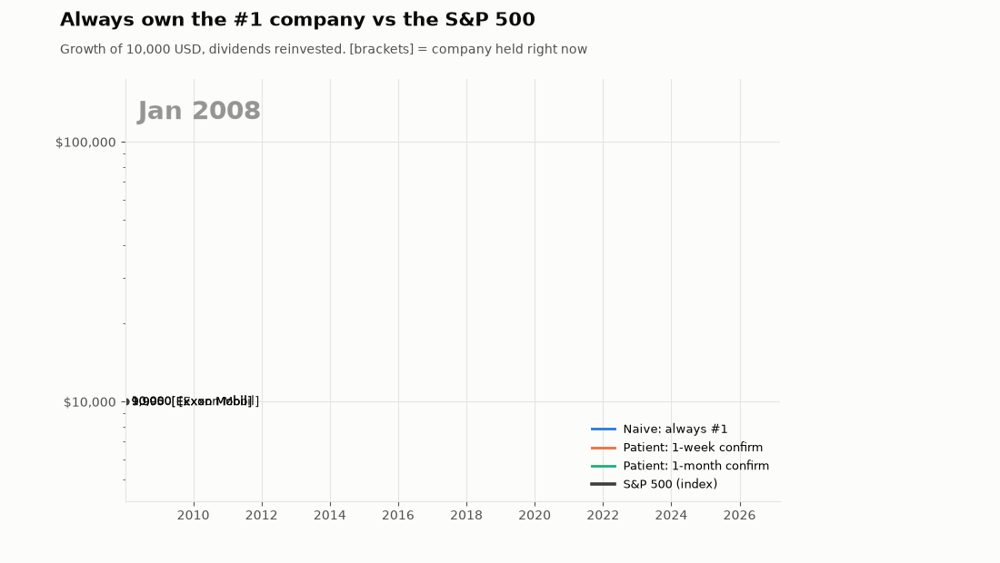
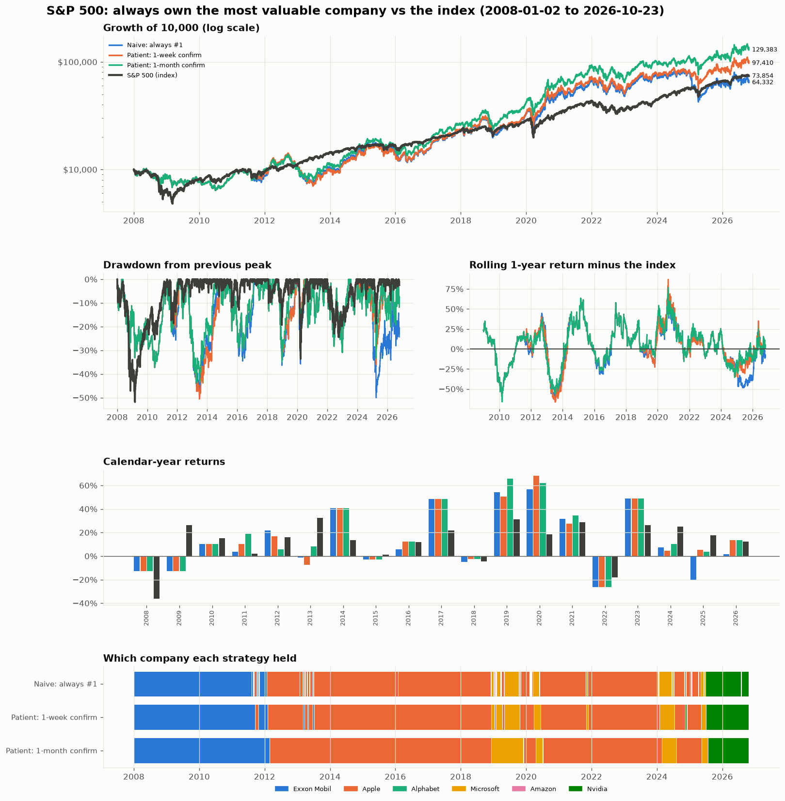

# Leader vs Index

**What if, instead of buying the whole index, you only ever owned its single most valuable company, and switched every time a new company took the #1 spot?**

This project backtests that idea against five indices (S&P 500, Nasdaq-100, Dow Jones, FTSE 100, DAX), with an animated "race" chart, comparison charts and tables.



## The two models

| | **Model 1: Naive** | **Model 2: Patient** |
|---|---|---|
| When to switch | The moment a different company becomes #1 | Only when the new #1 has been #1 for a **confirmation period** (default: one model at 7 days and one at 30) |
| If your company slips to #2 | Switch | **Keep holding** |
| If your company falls to #3 or lower | Switch | **Switch straight away** to the current #1 |
| New IPOs | Allowed straight away | Must have traded for **365 days** first |
| Transaction costs | Ignored (0 bps) | 10 bps per switch |

All of these are settings: `--confirm-days`, `--min-age-days`, `--drop-rank`, `--cost-bps`, `--naive-cost-bps` on the command line, or the sliders in the app.

Decisions are made at each day's close using that day's market caps, and the trade happens at that close, so there is no look-ahead. Returns include reinvested dividends for both the strategies and the index.

## Results (2008-01-02 → 2026-10-23, $10,000 start)

| Index | Naive | Patient (1 week) | Patient (1 month) | **Index** |
|---|---|---|---|---|
| S&P 500 | 10.4% / yr (98 trades) | 12.9% / yr (26) | **14.6% / yr** (10) | 11.2% / yr |
| Nasdaq-100 | 13.6% (70) | 16.2% (18) | **16.7%** (10) | 16.0% |
| Dow Jones | 7.6% (72) | 10.8% (18) | **11.0%** (10) | 10.0% |
| FTSE 100 *(from 2009)* | 2.6% (81) | 2.7% (19) | 3.2% (9) | **7.8%** |
| DAX | 2.5% (106) | 2.3% (32) | 0.9% (22) | **6.4%** |

What the backtest shows:

* **Constant switching hurts.** The naive model lost to the index in every market, even with zero costs. The leaders kept trading places for days at a time (Apple, Microsoft and Nvidia in 2024–25, for example), and every switch came right after the new leader had risen and the old one had fallen, so it often bought just before the move reversed.
* **Patience helps.** Waiting a month before switching, and holding through a drop to #2, beat all three US indices, by between 0.7 percentage points a year (Nasdaq-100) and 3.4 (S&P 500). In the S&P 500 it spent 61% of the time in Apple and 22% in Exxon.
* **It's much riskier.** Volatility was about 30% a year against about 20% for the index, and Sharpe ratios were lower. The extra return came with a lot more ups and downs.
* **Outside the US it failed.** The FTSE's leaders (Shell, AstraZeneca) and the DAX's (Volkswagen, Bayer, SAP) lagged their indices badly.

Full tables are in `results/<index>/report.md`, with a chart dashboard in `results/<index>/dashboard.png`.



## Running it

```bash
git clone https://github.com/SidiqB/leader-vs-index.git
cd leader-vs-index
python3 -m venv .venv && source .venv/bin/activate
pip install -r requirements.txt
```

**Interactive app.** Pick any index from the dropdown and it re-runs on its own: the race chart plays, then the comparison charts and tables appear.

```bash
streamlit run app.py
```

**Command line.** Shows the animation in a window, prints the tables, and saves everything to `results/<index>/`.

```bash
python run.py                    # choose an index from a menu
python run.py --index nasdaq100  # or name it
python run.py --all --no-show    # every index, files only
python run.py --index sp500 --start 2012-01-01 --confirm-days 14 60 --cost-bps 25
```

The first run downloads data (about 30 seconds per index). After that it is cached in `data_cache/` for a day; add `--offline` to use only the cache.

**Tests:** `pytest`

## Outputs per index

| File | What |
|---|---|
| `race.gif` | The animated chart |
| `dashboard.png` | Growth, drawdowns, rolling excess return, yearly returns, holdings timeline |
| `report.md` | All tables in one readable file |
| `summary.csv` | Final value, CAGR, volatility, Sharpe, Sortino, max drawdown, trades… |
| `yearly_returns.csv` | Calendar-year returns of each strategy and the index |
| `holdings_*.csv` | Every period a company was held, its return and the index's return over the same period |
| `trades_*.csv` | Every switch and why it happened |
| `leader_changes.csv` | Every time the #1 company changed |
| `time_in_each_company.csv` | Share of time spent in each company |

## How it works

```
leadertrack/
  indices.py     index definitions: benchmark ETF + candidate companies with join/leave dates
  data.py        prices, dividends, share counts → historical market caps (cached)
  strategies.py  naive + patient models
  analysis.py    metrics and tables
  plots.py       matplotlib animation + static charts
app.py           Streamlit dashboard
run.py           command line
```

**Market cap** = unadjusted price × shares outstanding on that day. Share counts come from Yahoo Finance (about 2015 onwards) joined onto SEC EDGAR filings (about 2007 onwards, US companies only).

## Caveats

* **Share counts before about 2007 (US) or 2015 (UK/Germany) are estimates.** The earliest known count is carried backwards, so when two companies were close, early rankings can be wrong. The app warns you when the start date is that early.
* **Candidate pools are hand-picked** (the 11–25 companies that realistically competed for #1), not the full historical membership. Join/leave dates are approximate. Add companies in `indices.py`.
* **Taxes are ignored.** Every switch would be a taxable sale in a normal account.
* **Dow note:** the Dow is price-weighted, but "most valuable" here still means largest market cap among its members.
* **FTSE benchmark:** Yahoo has ISF.L dividends only from 2013, so the FTSE index return is slightly understated before then.
* None of this is investment advice.
