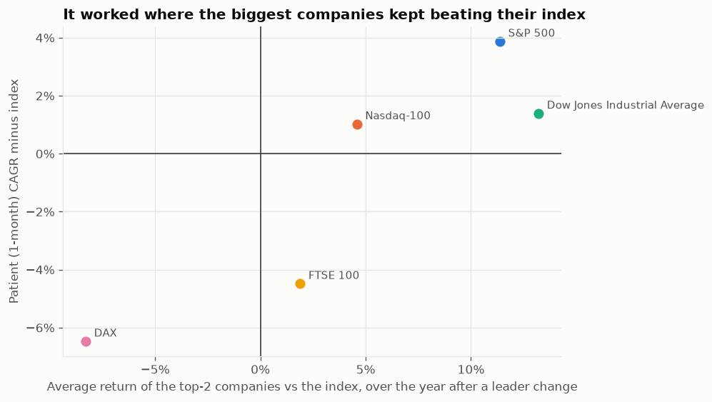
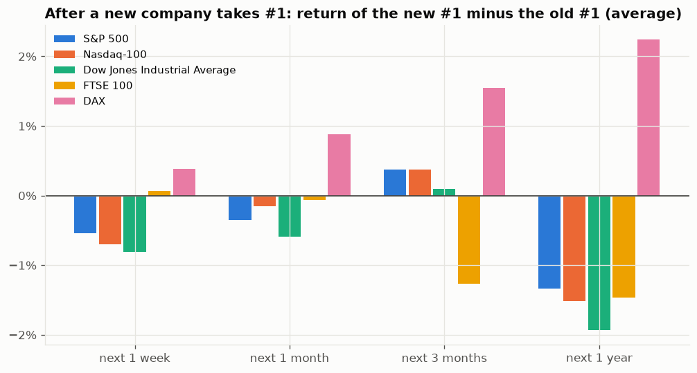

# Why does "own the #1 company" work in some markets and not others?

Backtest window: 20 years, Oct 2006 → Oct 2026 (FTSE 100 from Jan 2009). Everything here can be regenerated with `python research.py`. The tables and charts are in [`research/`](research/).

## Short answer

The strategy only works when **three things are true at once**, and over this window they were only all true in the US:

1. **The market's biggest companies beat the market as a whole.** In the US, the top two companies (Apple, Microsoft, Exxon, later Nvidia) beat the index by about 4–14% on average in the year after each leadership change. In the UK and Germany the top companies (Shell, Volkswagen, E.ON, Bayer) roughly matched or lagged their index. If the companies you're choosing between don't beat the index, no rule for switching between them can.
2. **You don't chase every change at the top.** About 3.5–6 times a year the #1 spot changed hands, and in 67–80% of cases it **flipped back within a month**. The new #1 had usually just beaten the index by about 2–3.5% in the month before taking the top spot. Switching right then means buying after a spike, so you pay for the noise every time. That's why the naive model lost everywhere.
3. **Staying with the old #1 pays off.** In the US and UK, the company that just *lost* the #1 spot did better than the one that took it over the next year (by 1.3–1.9 percentage points on average). The patient model's "keep holding while it's #2" rule captures exactly this. In Germany it was the other way round, so patience hurt there.

## 1. Being #1 is usually the end of a run, not the start

Across all five markets, the company that just took #1 had beaten the index by an average of **2.2–3.5% in the previous month alone**:

| Index | Leader changes in 20 yrs | New #1, month before vs index | New #1, next week vs index | Flipped back within a month |
|---|---|---|---|---|
| S&P 500 | 120 | +2.7% | −0.3% | 79% |
| Nasdaq-100 | 69 | +3.4% | −0.6% | 74% |
| Dow Jones | 94 | +3.4% | −0.7% | 79% |
| FTSE 100 | 74 | +2.2% | +0.3% | 80% |
| DAX | 78 | +3.5% | +0.6% | 67% |

In the US, the new leader then **gave some of it back in the following week**. This matches a well-documented effect called *short-term reversal*: stocks that jumped over the past week or month tend to partly fall back over the next one ([Jegadeesh 1990; Lehmann 1990](https://alphaarchitect.com/blog/2015/01/14/quantitative-momentum-research-short-term-return-reversal/); [Columbia review](https://business.columbia.edu/sites/default/files-efs/pubfiles/11568/str1.pdf)). [Kelly & Gutierrez](https://breesefine7110.tulane.edu/wp-content/uploads/sites/16/2015/10/Weekly-Momentum-Kelly-and-Gutierrez.pdf) find the reversal lasts about two weeks, after which longer-term momentum takes over.

This is the mechanism behind the naive model's losses. It buys at the moment of the spike, and most of the time the move unwinds and it switches back, losing a little each round trip. Waiting a week or a month steps past that reversal window, which is why the 1-week and 1-month patient models did so much better than the naive one in every market except Germany.

## 2. After a change, the old #1 usually beats the new one

Average return of the new #1 *minus* the old #1 after a leadership change:

| Index | Next week | Next month | Next 3 months | Next year |
|---|---|---|---|---|
| S&P 500 | −0.5% | −0.4% | +0.4% | **−1.3%** |
| Nasdaq-100 | −0.7% | −0.2% | +0.4% | **−1.5%** |
| Dow Jones | −0.8% | −0.6% | +0.1% | **−1.9%** |
| FTSE 100 | +0.1% | −0.1% | −1.3% | **−1.5%** |
| DAX | +0.4% | +0.9% | +1.5% | **+2.2%** |

The patient model holds on while its company slips to #2. Measured directly, on the days it held the #2 company instead of buying the #1:

| Index | Days held at #2 (1-month model) | Held #2 vs the #1 it didn't buy |
|---|---|---|
| S&P 500 | 390 | **+142%** |
| Dow Jones | 354 | **+113%** |
| Nasdaq-100 | 266 | **+67%** |
| FTSE 100 | 272 | +1% |
| DAX | 400 | **−56%** |

**Careful: this is lumpy.** The single biggest S&P 500 day was 27 Jan 2025, the "DeepSeek" sell-off, when Nvidia (#1) fell about 17% while the strategy was still holding Apple (#2). That one day accounts for about +22% of the figure. The edge rests on a handful of big days, not a steady pattern, and hit rates were close to 50/50: the old #1 beat the new one in about half of the changes.

This lines up with the wider evidence that **reaching the top tends to come after the best returns, not before them**. [Dimensional's study](https://www.dimensional.com/chmedia/359932/source/download/think-twice-about-chasing-the-biggest-stocks.pdf) of US stocks entering the top 10 (1927–2025) found they had beaten the market by a wide margin in the three years before joining, then on average lagged it within five years after. [Rob Arnott at Research Affiliates](https://ioandc.com/rob-arnott-sell-the-top-dogs) reported that seven out of eight of the world's #1 companies over 40 years underperformed enough over the next decade to lose the top spot.

Our own data agrees. Here is how each company did *while it was #1* compared with over the whole 20 years:

| Company | Index | Share of time at #1 | vs index while #1 (a year) | vs index, whole 20 yrs (a year) |
|---|---|---|---|---|
| Apple | S&P 500 | 58% | +2.3% | +17.2% |
| Exxon Mobil | S&P 500 | 24% | −1.3% | −2.4% |
| Microsoft | S&P 500 | 8% | +5.2% | +6.9% |
| Nvidia | S&P 500 | 7% | −18.3% | +24.2% |
| Shell | FTSE 100 | 80% | −0.7% | +1.9% |
| SAP | DAX | 44% | +0.4% | +3.3% |
| Volkswagen | DAX | 20% | −3.7% | −1.7% |

Apple and Nvidia made most of their gains **on the way up to #1**. Once at the top, they mostly just kept pace with the index.

## 3. The real driver: were the giants winners in that market?

If being #1 doesn't predict outperformance, why did the patient strategy beat the S&P 500 by about 4 points a year?

Because over 2006–2026, **the US largest companies as a group kept beating the index** whether or not they were #1. Both the new and old leaders beat the S&P 500 by about 11–12% on average over the year after each change (Dow: 12–14%, Nasdaq-100: 4–5%). This was the era of a few US tech giants (Apple, Microsoft, Nvidia) taking a bigger and bigger share of the market. Any strategy that kept you in one of the top two US companies was carried along.

The UK and Germany had no such tech giants. Their #1 companies came from old, slow-growing, often cyclical or regulated industries: oil (Shell), cars (Volkswagen), utilities (E.ON), chemicals and pharma (Bayer). Over 2006–2026 the top FTSE companies beat the index by only 1–3% a year and the top DAX companies **lagged it by 7–9%** after leadership changes. Owning the single biggest one meant concentrating in the market's weakest areas: oil price crashes (2014, 2020), Volkswagen's diesel emissions scandal (2015), Bayer's Monsanto lawsuits.

Sector of the company held most of the time:

| Index | Mostly held | Sector |
|---|---|---|
| S&P 500 / Nasdaq / Dow | Apple, Microsoft, Nvidia (Exxon in 2006–11) | Tech |
| FTSE 100 | Shell (80% of the time) | Energy |
| DAX | SAP, Volkswagen, Siemens, E.ON, Bayer | Mixed, mostly old industry |

## 4. Luck and concentration

[Bessembinder](https://wpcarey.asu.edu/department-finance/faculty-research/do-stocks-outperform-treasury-bills) found that just 4% of US stocks account for **all** of the US stock market's net gains since 1926, and most individual stocks do worse than cash. A one-stock strategy is a bet on happening to hold one of those few big winners. Over the last 20 years in the US, the #1 company *was* one of them (Apple, then Nvidia). In most other periods and markets it wasn't.

The results also lean heavily on single stretches. For the S&P 500 1-week patient model, taking away its best stretch (Apple, July 2013 → December 2018) turns its lead over the index into a loss. The 1-month model was more robust, still ahead without its best stretch.

## Conclusions

* **The naive version doesn't work anywhere.** Constant switching buys after a short-term spike, and that spike usually reverses.
* **The patient version worked in the US because of the period, not because of a reliable rule.** It rode the biggest-tech era while avoiding most of the back-and-forth at the top. There's no strong reason to expect the next 20 years to look the same: the longer history (Dimensional, Research Affiliates) says #1 companies usually lag afterwards.
* **Where the biggest companies are old-economy firms (UK, Germany), it lost badly.** It concentrated you in the slowest-growing part of the market.
* **Risk is much higher in every case.** Volatility was about 30% a year against about 20% for the index, with single-day swings of over 20%.
* **What would make it work in future:** a market whose largest companies keep beating everyone else. You can't know that in advance, which is the argument for owning the whole index.

## Caveats

* Rankings rely on estimated market caps (price × share count). Share counts before about 2007 (US) or 2015 (UK/Germany) are estimates, which especially affects Shell's lead before 2016 and the German rankings in 2006–2010.
* The leadership changes overlap and cluster: 26 of the S&P 500's 120 changes happened in 2024–25, when Apple, Microsoft and Nvidia kept trading places, and another 52 in 2007, 2019 and 2020. The averages are not 120 independent experiments.
* Candidate pools are hand-picked lists of large companies, not full historical index membership.
* This is not investment advice.
